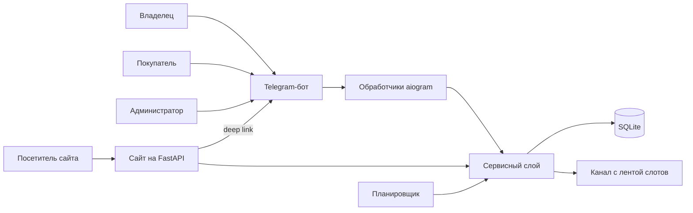

# SlotMarket: техническое задание

Версия 1.0 от 11.11.2026. Название рабочее, можно заменить (например, «Empty Hour»).

Документ состоит из двух частей. Часть A описывает идею и её подачу на Blue Ocean Competition. Часть B — техническое задание на MVP.

---

# Часть A. Идея

## A1. Одной фразой

> «Мы показываем малому бизнесу, сколько он теряет на пустом времени, и помогаем продать его до того, как оно сгорит».

## A2. Проблема

Малый бизнес, который продаёт время (салоны, барбершопы, фотостудии, репетиторы, переговорки), теряет деньги на простоях. Время нельзя сохранить на завтра. При этом владелец не знает, сколько именно он теряет: он видит выручку, но не видит стоимость пустых часов.

## A3. Решение

Один сервис из двух шагов.

**Шаг 1. Диагностика (калькулятор потерь).** Владелец вводит цену услуги, количество рабочих часов, загрузку и расходы. Сервис показывает: «Вы теряете X ₽ в месяц на пустых часах. Самые слабые слоты: вторник и четверг до 14:00».

**Шаг 2. Возврат денег (продажа слотов).** Владелец отмечает свободное время и минимальную цену. Сервис:

1. находит желающих купить слот сегодня или завтра;
2. предлагает цену, которая падает по мере приближения времени;
3. подтверждает бронь и уведомляет обе стороны;
4. показывает владельцу, сколько удалось вернуть из потерянных денег.

## A4. Почему это blue ocean

- Мы не система записи (YClients, Booksy) и не агрегатор скидок (Groupon). Мы работаем с пустым временем как с товаром, у которого есть срок годности.
- Новые клиенты: люди, которые не планируют заранее (студенты, фрилансеры, те, кому нужно «сегодня»).
- Новая ценность: бизнес сначала видит цифру потерь, поэтому платить за решение ему очевидно.

### ERRC

|Убрать|Снизить|Повысить|Создать|
|---|---|---|---|
|Предоплату и долгий поиск|Стоимость привлечения клиента|Скорость заполнения слота|Биржу слотов с падающей ценой и расчёт «цены пустого часа»|

## A5. Целевая аудитория

Старт с одной ниши в одном городе, например барбершопы или фотостудии. Это даёт реальных людей для интервью и тестовых продаж.

- **Бизнес:** небольшие точки с 1–10 рабочими местами и загрузкой ниже 80%.
- **Покупатели:** студенты, фрилансеры и все, кому услуга нужна сегодня или завтра и важна цена.

## A6. Монетизация

- Комиссия 10–15% с проданного слота. Бизнес платит только за результат.
- Позже подписка за расширенную аналитику (по загрузке, дням, услугам).

В MVP комиссия не взимается: оплата идёт на месте, а бот только считает, какой была бы комиссия. Эта цифра нужна для финансовой модели в питче.

## A7. План проверки для конкурса

1. 10 интервью с владельцами: сколько пустых часов, как справляются, готовы ли продавать со скидкой.
2. Калькулятор потерь в Google Sheets, чтобы показать каждому его цифру. Это же сильный слайд для питча.
3. Ручной тест: 3–5 бизнесов, публикация слотов в Telegram-канале, 3–5 реальных продаж.
4. Питч из шести слайдов: проблема с цифрами из интервью, решение, ERRC, результаты теста, модель дохода, следующие шаги.

## A8. Главные риски и ответы

|Риск|Ответ|
|---|---|
|«Скидки портят бренд»|Режим скрытого названия: в ленте видны только категория, район, время и цена. Название и адрес покупатель узнаёт после брони. Слоты выставляются только на то время, которое выбрал владелец|
|«Холодный старт»|Одна ниша и один канал, первые продажи делаются вручную до автоматизации|
|«Чем лучше Booksy?»|Они решают «как записать». Мы решаем «как продать то, что иначе пропадёт»|
|Неявки без предоплаты|Телефон обязателен, лимит активных броней, блокировка после двух неявок|

---

# Часть B. Техническое задание на MVP

## B1. Цель и рамки

**Цель MVP:** доказать на 3–5 реальных бизнесах, что владелец готов выставлять пустые слоты со скидкой, а покупатели готовы их бронировать.

**Допущения:**

- команда — два школьника и наставник;
- срок до защиты — несколько недель;
- первый запуск — одна ниша в одном городе.

**Входит в MVP:**

- калькулятор потерь от простоев;
- регистрация бизнеса и услуг;
- публикация слотов владельцем;
- автоматическое снижение цены;
- лента слотов в Telegram-канале и бронирование через бота;
- уведомления;
- отчёт владельцу «сколько возвращено»;
- статистика для команды;
- сайт: лендинг, веб-калькулятор и витрина слотов (раздел B16).

**Не входит в MVP:**

- онлайн-оплата (клиент платит на месте);
- мобильное приложение;
- регистрация, личный кабинет и бронирование на сайте (всё это остаётся в боте);
- интеграции с YClients, Dikidi и другими системами записи;
- несколько городов и ниш;
- отзывы и рейтинги бизнесов.

Онлайн-оплата отложена ещё и потому, что приём платежей требует юрлица или статуса самозанятого, а участники несовершеннолетние.

## B2. Роли

|Роль|Что делает|
|---|---|
|Владелец бизнеса|Считает потери, публикует слоты, подтверждает визиты, получает отчёты|
|Покупатель|Смотрит ленту, бронирует слот, приходит и платит на месте|
|Администратор (команда)|Одобряет новые бизнесы, смотрит статистику, разбирает споры|

Один пользователь Telegram может быть и владельцем, и покупателем. Роль выбирается в главном меню.

## B3. Пользовательские сценарии

### B3.1. Владелец

1. Открывает бота по ссылке от команды и выбирает «Я владелец».
2. Проходит калькулятор и получает цифру потерь в месяц.
3. Регистрирует бизнес: название, категория, район, адрес, телефон.
4. Добавляет услуги: название, длительность, обычная цена.
5. Ждёт одобрения администратора.
6. Создаёт слот: услуга, дата, время, минимальная цена, режим скрытого названия.
7. Получает уведомление о брони с именем и телефоном клиента.
8. Через час после начала слота отвечает «пришёл» или «не пришёл».
9. Раз в неделю получает отчёт.

### B3.2. Покупатель

1. Видит слот в канале и нажимает «Забронировать». Кнопка открывает бота по deep link. При первом входе принимает согласие на обработку данных (B5).
2. При первой брони отправляет телефон кнопкой Telegram.
3. Видит текущую цену и подтверждает бронь.
4. Получает название, адрес и телефон бизнеса.
5. Получает напоминания за 2 часа и за 30 минут.
6. Может отменить бронь не позднее чем за 1 час до начала.

### B3.3. Администратор

1. Получает заявку нового бизнеса и одобряет или отклоняет её.
2. Смотрит статистику командой `/stats`.
3. Выгружает данные в CSV командой `/export`.
4. Блокирует бизнес или покупателя при нарушениях.

## B4. Функциональные требования

### B4.1. Калькулятор потерь

**Входные данные:**

|Параметр|Пример|
|---|---|
|Число рабочих мест (кресел, залов)|3|
|Рабочих часов в день|10|
|Рабочих дней в месяц|26|
|Средняя загрузка, %|60|
|Средняя выручка за час, ₽|1500|
|Переменные расходы на час, ₽ (материалы, доля мастера)|600|
|Самые пустые дни и время (необязательно)|вт, чт до 14:00|

**Формулы:**

```
доступные_часы    = места × часы_в_день × дни_в_месяц
пустые_часы       = доступные_часы × (1 − загрузка)
упущенная_выручка = пустые_часы × выручка_за_час
реальный_возврат  = пустые_часы × доля_продаж × (цена_со_скидкой − переменные_расходы)
```

- `доля_продаж` по умолчанию равна 25%. Это допущение, его нужно заменить реальной цифрой после теста.
- `цена_со_скидкой` по умолчанию равна 65% от выручки за час.

**Пример:** 3 × 10 × 26 = 780 часов; пустых 312; упущенная выручка 468 000 ₽; реальный возврат 312 × 0,25 × (975 − 600) = 29 250 ₽ в месяц.

**Вывод бота:**

- упущенная выручка в месяц;
- реалистичная сумма возврата. Если цена со скидкой не покрывает переменные расходы и возврат выходит отрицательным, показывается и сохраняется 0 с пояснением, что продажа со скидкой убыточна;
- рекомендуемая минимальная цена слота по формуле из B4.3, где длительность равна 60 минутам, а обычная цена равна выручке за час;
- самые слабые слоты. В MVP это дни и время, которые владелец указал сам. После накопления данных — статистика по его слотам.

Результат сохраняется в `calc_reports`. Калькулятор доступен без регистрации бизнеса.

### B4.2. Бизнес и услуги

- Поля бизнеса: название, категория, район, адрес, телефон.
- Новый бизнес получает статус `pending` и не может публиковать слоты до одобрения.
- У бизнеса может быть несколько услуг. Услугу можно изменить или скрыть, но нельзя удалить, если по ней есть слоты.

### B4.3. Слоты

- Слот создаётся не раньше чем за 48 часов и не позже чем за 2 часа до начала.
- Минимальная цена должна быть не меньше 30% и не больше 90% обычной.
- Бот предупреждает, если минимальная цена ниже переменных расходов из калькулятора.
- Владелец может снять слот, пока он не забронирован.
- Слот автоматически закрывается за 30 минут до начала, если его никто не купил.
- Быстрое создание: кнопка «Повторить вчерашние слоты».

**Рекомендуемая минимальная цена** (`core/pricing.py`):

```
переменные = переменные_расходы_в_час × длительность_мин / 60
прибыль    = 10% × переменные
пол        = переменные + прибыль
мин_цена   = зажать(округлить_вверх_до_50(пол), 30% × обычная, 90% × обычная)
```

- Комиссия в пол не входит, пока она не взимается. Ставка 15% хранится константой и используется только для справочного расчёта в отчёте (B4.8).
- Если пол выше 90% обычной цены, бот показывает 90% и предупреждает, что продажа по этой цене не даёт нужной прибыли.

### B4.4. Снижение цены

Стартовая цена равна обычной цене минус 15%. Дальше цена падает линейно до минимальной, ступенями раз в 30 минут, с округлением до 50 ₽:

```
T0   = время до начала в момент публикации
t    = время до начала сейчас
доля = max(0, (t − 2 ч) / (T0 − 2 ч))
цена = мин_цена + (старт_цена − мин_цена) × доля
```

- За 2 часа до начала цена достигает минимума и больше не меняется.
- Если слот опубликован меньше чем за 2,5 часа до начала, он сразу продаётся по минимальной цене.
- Покупатель платит ту цену, которая была в момент брони. Она фиксируется в `bookings.price`.

### B4.5. Бронирование

- Один слот — одна бронь.
- Гонка двух покупателей решается атомарным обновлением: `UPDATE slots SET status='booked' WHERE id=? AND status='open'`. Бронь получает тот, чей запрос изменил строку. Второй видит сообщение «Слот только что забрали».
- У покупателя не больше двух активных броней одновременно.
- Отмена покупателем возможна не позднее чем за 1 час до начала. При отмене слот возвращается в ленту, если до начала больше 30 минут.
- После двух неявок покупатель блокируется на 30 дней.
- Если владелец не ответил «пришёл или нет» за 24 часа, бронь считается состоявшейся.

### B4.6. Лента слотов

- Бот публикует каждый новый слот в канал города.
- Обычный пост: услуга, название бизнеса, район, время, текущая цена, зачёркнутая обычная цена, кнопка «Забронировать».
- Пост в режиме скрытого названия: категория, услуга, район, время, цена, кнопка. Название и адрес открываются после брони.
- При изменении цены бот редактирует существующий пост.
- После брони пост помечается «Забронировано», после истечения — «Время вышло».
- В боте есть команда «Слоты сегодня» с фильтром по категории.

### B4.7. Уведомления

|Событие|Кому|
|---|---|
|Бизнес одобрен или отклонён|Владельцу|
|Новая бронь|Владельцу|
|Отмена брони|Владельцу|
|Бронь подтверждена: название, адрес, телефон|Покупателю|
|Напоминание за 2 часа и за 30 минут|Покупателю|
|Слот снят бизнесом после брони|Покупателю|
|Слот не продан и закрыт|Владельцу|
|Запрос «клиент пришёл?» через час после начала|Владельцу|
|Недельный отчёт|Владельцу|
|Новая заявка бизнеса|Администратору|

### B4.8. Отчёт владельцу

Раз в неделю и по команде:

- опубликовано, продано, не продано слотов;
- возвращено денег (сумма цен состоявшихся броней);
- средняя скидка;
- неявки;
- сравнение с цифрой из калькулятора: «возвращено N% от потерь»;
- расчётная комиссия сервиса (справочно, не взимается).

### B4.9. Администрирование

- `/pending` — заявки бизнесов с кнопками «Одобрить» и «Отклонить».
- `/stats` — слоты, брони, неявки, возвращённые деньги, число активных бизнесов и покупателей.
- `/export` — выгрузка слотов и броней в CSV.
- `/block` — блокировка бизнеса или покупателя.
- Список администраторов задаётся в конфигурации по Telegram ID.

## B5. Нефункциональные требования

|Требование|Значение|
|---|---|
|Нагрузка|До 30 бизнесов и 1000 покупателей|
|Скорость ответа бота|Не дольше 2 секунд|
|Точность смены цены|Отставание не больше 5 минут|
|Доступность|Автоперезапуск через systemd|
|Резервные копии|Ежедневная копия файла базы, хранить 7 дней|
|Время|В базе UTC, пользователю показывается время города|
|Стоимость|Сервер 300–500 ₽ в месяц, домен 200–1000 ₽ в год|

**Персональные данные:**

- хранятся только имя, Telegram ID и телефон;
- телефон покупателя виден владельцу только после брони;
- при первом входе пользователь принимает согласие на обработку данных;
- пользователь может удалить свои данные командой `/delete_me`;
- токен бота и ID администраторов лежат в файле `.env`, который не попадает в репозиторий.

## B6. Архитектура



**Стек бота:** Python 3.12, aiogram 3, SQLAlchemy 2, SQLite, APScheduler.

**Стек сайта:** FastAPI, Jinja2, Tailwind CSS, Alpine.js, uvicorn, Caddy. Подробности и обоснование в разделе B16.

**Компоненты:**

- **Обработчики** принимают сообщения и нажатия кнопок, проверяют ввод и вызывают сервисный слой. Бизнес-логики в них нет.
- **Сервисный слой** содержит модули `calculator`, `pricing`, `slots`, `bookings`, `reports`, `feed`. Он не зависит от Telegram, поэтому позже к нему можно подключить сайт или Mini App.
- **Планировщик** раз в 5 минут пересчитывает цены, закрывает просроченные слоты, рассылает напоминания. Раз в неделю рассылает отчёты.
- **Канал** служит витриной: в него пишет только бот.
- **Сайт** работает отдельным процессом на том же сервере, использует тот же сервисный слой и ту же базу. SQLite включается в режиме WAL, чтобы бот и сайт могли работать с базой одновременно.

**Структура проекта:**

```
slotmarket/
  bot/
    handlers/      owner.py, buyer.py, admin.py, common.py
    keyboards.py
    states.py
  web/
    app.py         маршруты FastAPI
    templates/     base.html, index.html, calc.html, slots.html, privacy.html
    static/        стили, картинки, favicon
  core/
    calculator.py
    pricing.py
    slots.py
    bookings.py
    reports.py
    feed.py
  db/
    models.py
    session.py
  jobs.py
  config.py
  main.py
tests/
  test_pricing.py
  test_calculator.py
  test_bookings.py
```

## B7. Модель данных

|Таблица|Поля|
|---|---|
|`users`|id, tg_id (уникальный), name, phone, is_owner, no_show_count, blocked_until, consent_at, created_at|
|`businesses`|id, owner_id, name, category, district, address, phone, status, created_at|
|`services`|id, business_id, title, duration_min, regular_price, is_active|
|`slots`|id, service_id, starts_at, start_price, min_price, current_price, hide_name, status, channel_msg_id, published_at|
|`bookings`|id, slot_id, buyer_id, price, status, created_at, cancelled_at, cancelled_by|
|`calc_reports`|id, user_id (пусто для расчётов с сайта), token, source (bot / web), seats, hours_per_day, days_per_month, load_pct, revenue_per_hour, variable_cost, weak_slots, lost_revenue, recoverable, created_at|
|`events`|id, user_id, type, payload (JSON), created_at|

**Статусы:**

- `businesses.status`: `pending`, `approved`, `blocked`.
- `slots.status`: `open`, `booked`, `done`, `no_show`, `expired`, `withdrawn`.
- `bookings.status`: `active`, `cancelled`, `done`, `no_show`.

**Переходы статуса слота:**

|Из|В|Причина|
|---|---|---|
|`open`|`booked`|Покупатель забронировал|
|`open`|`expired`|До начала осталось 30 минут|
|`open`|`withdrawn`|Владелец снял слот|
|`booked`|`open`|Покупатель отменил, до начала больше 30 минут|
|`booked`|`withdrawn`|Владелец отменил после брони|
|`booked`|`done`|Владелец подтвердил визит или прошло 24 часа|
|`booked`|`no_show`|Владелец отметил неявку|

**Индексы:** `slots(status, starts_at)`, `bookings(buyer_id, status)`, `users(tg_id)`.

Таблица `events` нужна для метрик: в неё пишется каждое значимое действие (прошёл калькулятор, создал слот, открыл слот, забронировал, отменил).

## B8. Интерфейс бота

**Команды:**

|Команда|Кто|Действие|
|---|---|---|
|`/start`|Все|Главное меню, выбор роли, обработка deep link|
|`/calc`|Все|Калькулятор потерь|
|`/slots`|Покупатель|Слоты на сегодня и завтра|
|`/my`|Покупатель|Мои брони|
|`/business`|Владелец|Бизнес и услуги|
|`/new`|Владелец|Создать слот|
|`/report`|Владелец|Отчёт|
|`/delete_me`|Все|Удалить свои данные|
|`/pending`, `/stats`, `/export`, `/block`|Администратор|Управление|

**Deep links:**

- `t.me/<бот>?start=slot_<id>` — открыть слот из канала;
- `t.me/<бот>?start=owner` — приглашение владельца сразу в калькулятор;
- `t.me/<бот>?start=calc_<token>` — переход с сайта: бот находит расчёт по токену и привязывает его к пользователю.

**Пример поста в канале:**

```
✂️ Мужская стрижка
📍 Барбершоп «Борода», Центр
🕒 Сегодня, 15:00

Цена сейчас: 900 ₽  (обычно 1500 ₽)
Цена снижается до начала. Слот один.

[ Забронировать ]
```

## B9. Крайние случаи

|Ситуация|Поведение|
|---|---|
|Владелец продал слот сам, мимо бота|Снимает слот кнопкой. Если слот уже забронирован, покупатель получает уведомление, отмена фиксируется за бизнесом|
|Два покупателя жмут одновременно|Бронь у первого, второй видит «Слот только что забрали»|
|Покупатель не пришёл|Счётчик неявок растёт, после двух неявок блокировка на 30 дней|
|Бот перезапустился|Планировщик пересчитывает цены и статусы по времени из базы|
|Канал недоступен или пост удалён|Ошибка пишется в лог, слот остаётся доступным через `/slots`|
|Покупатель заблокировал бота|Напоминание не доставлено, бронь остаётся в силе|
|Владелец трижды отменил слоты после брони|Администратор получает уведомление и решает, блокировать ли бизнес|
|Некорректный ввод (цена, дата)|Бот повторяет вопрос с примером правильного формата|

## B10. Метрики

|Метрика|Цель теста|
|---|---|
|Доля проданных слотов от опубликованных|От 30%|
|Среднее время от публикации до брони|Фиксируем|
|Средняя скидка в момент покупки|Фиксируем|
|Доля неявок|Ниже 15%|
|Возвращено денег на один бизнес в неделю|Фиксируем|
|Доля владельцев, выставивших слот после калькулятора|От 30%|
|Доля владельцев, выставивших слоты повторно на второй неделе|От 50%|

## B11. Тестирование и приёмка

**Автотесты (pytest):**

- расчёт цены: начало, середина, последние 2 часа, поздняя публикация, округление;
- формулы калькулятора на примере из B4.1;
- бронирование: гонка двух покупателей, лимит броней, отмена, блокировка после неявок;
- переходы статусов слота.

**Ручная проверка перед запуском:** полный путь владельца и покупателя на двух телефонах.

**Критерии приёмки MVP:**

1. Владелец без помощи команды проходит калькулятор, регистрирует бизнес и создаёт слот.
2. Слот появляется в канале, цена в посте снижается по расписанию.
3. Покупатель бронирует слот, обе стороны получают уведомления.
4. Второй покупатель не может забронировать тот же слот.
5. После визита владелец отмечает результат, цифра попадает в отчёт.
6. Администратор видит всё это в `/stats` и выгружает в CSV.

## B12. Компромиссы

|Решение|Что получаем|Чем платим|
|---|---|---|
|Telegram-бот вместо приложения|Запуск за недели, пользователю ничего не нужно устанавливать|Ограниченный интерфейс, зависимость от Telegram|
|Оплата на месте|Нет юридических сложностей|Выше риск неявок, комиссию собрать нельзя|
|SQLite|Ноль настройки, один файл|Переезд на PostgreSQL при росте|
|Ручное одобрение бизнесов|Защита от мусора|Не масштабируется дальше нескольких десятков|
|Линейное снижение цены|Легко объяснить владельцу и жюри|Не учитывает спрос|
|Канал как витрина|Готовая аудитория и уведомления без затрат|Нет персональной выдачи и поиска|
|Режим скрытого названия|Снимает страх «скидки портят бренд»|Покупателю сложнее выбрать, конверсия может быть ниже|
|Сайт на FastAPI и шаблонах вместо React или Next.js|Один язык, один сервер, общая логика с ботом|Интерфейс проще, сложную интерактивность делать труднее|
|Сайт без регистрации, бронь только в боте|Не нужны пароли, авторизация и защита аккаунтов|Покупателю без Telegram сервис недоступен|

## B13. План работ

|Этап|Срок|Результат|
|---|---|---|
|0. Проверка|1 неделя|10 интервью, калькулятор в Google Sheets, 3 согласившихся бизнеса|
|1. Основа бота|1 неделя|Регистрация, калькулятор, бизнес и услуги, создание слотов|
|2. Продажа|1 неделя|Лента в канале, бронирование, снижение цены, уведомления|
|2а. Сайт|3–5 дней, параллельно с этапом 2|Лендинг, веб-калькулятор, витрина слотов, домен и HTTPS|
|3. Тест|1–2 недели|Реальные слоты, сбор метрик, правки|
|4. Защита|3–4 дня|Питч с цифрами теста|

Этап 0 идёт без кода и не должен ждать разработки.

**Запасной вариант, если времени мало:** этапы 1–2 заменяются ручной работой. Команда сама публикует слоты в канале и принимает брони в личных сообщениях, учёт ведётся в Google Sheets. Для конкурса реальные продажи важнее готового кода.

## B14. Что пересмотреть при росте

- Онлайн-предоплата или депозит против неявок, вместе с ней комиссия.
- Интеграция с YClients и Dikidi, чтобы свободные слоты подтягивались сами.
- Цена, зависящая от спроса, а не только от времени.
- Автоматический поиск слабых слотов по истории загрузки.
- PostgreSQL, Mini App, личный кабинет и бронирование на сайте.
- Переход сайта на Next.js, если понадобится сложный интерфейс.
- Автоматическая проверка бизнесов, отзывы и рейтинги.
- Несколько городов и ниш, отдельные каналы для каждой.

## B15. Открытые вопросы

1. Срок до защиты и формат сдачи: работающий продукт, прототип или только питч.
2. Ниша и город для первого запуска.
3. Кто пишет код и какой у него опыт.
4. Правила конкурса о помощи наставника.
5. Доля продаваемых пустых часов (сейчас допущение 25%) — уточнить после теста.
6. Доменное имя сайта.

## B16. Сайт

### B16.1. Зачем нужен сайт

Бот остаётся основным продуктом. Сайт решает три задачи, которые бот решает плохо:

- **Доверие.** Владельцу и жюри проще показать ссылку на сайт, чем на бота.
- **Привлечение владельцев.** Калькулятор потерь на сайте работает без Telegram и без регистрации. Владелец видит свою цифру и только потом переходит в бота.
- **Витрина для покупателей.** Слоты видны по обычной ссылке, которой можно делиться где угодно.

Регистрации, личного кабинета и бронирования на сайте нет. Все действия, для которых нужно знать пользователя, идут в боте через deep link. Это избавляет от паролей и авторизации.

### B16.2. Страницы

|Адрес|Содержание|
|---|---|
|`/`|Лендинг: главная фраза, как это работает в три шага, блок для владельцев, блок для покупателей, кнопки «Посчитать потери» и «Смотреть слоты»|
|`/calc`|Калькулятор потерь: форма из семи полей, результат на той же странице, кнопка «Вернуть эти деньги» с переходом в бота|
|`/slots`|Витрина открытых слотов на сегодня и завтра: услуга, район, время, текущая и обычная цена, кнопка «Забронировать в Telegram»|
|`/privacy`|Согласие на обработку данных и политика конфиденциальности|

**Лендинг, порядок блоков:**

1. Заголовок: «Пустое время стоит денег. Мы помогаем их вернуть».
2. Три шага: посчитайте потери, выставьте пустые слоты, получите клиентов.
3. Для бизнеса: цифры из теста (сколько слотов продано, сколько денег возвращено).
4. Для покупателей: пример слота с падающей ценой.
5. Ответы на частые вопросы: скидки и бренд, неявки, стоимость.
6. Кнопки перехода в калькулятор, витрину и бота.

### B16.3. Функциональные требования

**Калькулятор:**

- поля и формулы совпадают с ботом (раздел B4.1), расчёт выполняет общий модуль `core/calculator.py`;
- результат пересчитывается сразу при изменении полей, без перезагрузки страницы;
- при нажатии «Вернуть эти деньги» расчёт сохраняется в `calc_reports` с `source = web` и случайным токеном, пользователь переходит по ссылке `t.me/<бот>?start=calc_<token>`;
- бот по токену находит расчёт и продолжает сценарий владельца с регистрации бизнеса, не задавая вопросы заново;
- неверный ввод подсвечивается у поля с подсказкой.

**Витрина слотов:**

- показывает только слоты в статусе `open`;
- слоты в режиме скрытого названия показываются без названия и адреса;
- цены обновляются автоматически раз в 60 секунд;
- фильтр по категории и по дню (сегодня, завтра);
- кнопка брони ведёт на `t.me/<бот>?start=slot_<id>`;
- если слотов нет, показывается предложение подписаться на канал.

**API сайта:**

|Метод и адрес|Назначение|
|---|---|
|`POST /api/calc`|Сохранить расчёт, вернуть токен и ссылку на бота|
|`GET /api/slots?category=&day=`|Список открытых слотов с текущими ценами в JSON|

### B16.4. Стек и обоснование

|Слой|Выбор|Почему|
|---|---|---|
|Сервер|FastAPI и uvicorn|Тот же Python, что и в боте, прямой доступ к сервисному слою и базе|
|Страницы|Шаблоны Jinja2|HTML собирается на сервере, не нужна отдельная сборка фронтенда|
|Стили|Tailwind CSS|Аккуратный адаптивный интерфейс без написания CSS с нуля|
|Интерактивность|Alpine.js|Хватает для калькулятора и обновления витрины, подключается одной строкой|
|Веб-сервер|Caddy|Автоматически получает и продлевает HTTPS-сертификат|
|Запуск|Отдельная служба systemd рядом с ботом|Сайт и бот перезапускаются независимо|

**Что рассматривалось и почему отклонено:**

- **Next.js или React на Vercel.** Красивее и гибче, но это второй язык, отдельная сборка и отдельный хостинг, а логику калькулятора и цен пришлось бы дублировать или выносить в API. Для четырёх страниц это лишняя сложность.
- **Конструктор (Tilda и подобные).** Самый быстрый путь к лендингу, но в нём нельзя показать живые слоты и использовать общий калькулятор.

**Запасной вариант:** если времени не хватает, делается только лендинг на конструкторе с кнопками на бота, а калькулятор и витрина остаются в боте и канале.

### B16.5. Нефункциональные требования

- **Адаптивность:** вёрстка сначала для телефона, проверка на ширине 360 пикселей.
- **Скорость:** первая загрузка страницы не дольше 2 секунд на мобильном интернете.
- **Безопасность:** только HTTPS; ограничение частоты запросов к `POST /api/calc` (не больше 10 в минуту с одного адреса); проверка всех входных данных на сервере.
- **Данные:** сайт не собирает имя и телефон. Расчёт с сайта анонимен, пока владелец сам не перейдёт в бота.
- **Поиск и соцсети:** заголовок и описание на каждой странице, картинка для предпросмотра ссылки.
- **Аналитика:** счётчик посещений и запись событий в таблицу `events`: открыл калькулятор, получил результат, перешёл в бота, открыл слот. Метки UTM из ссылки сохраняются вместе с расчётом.

### B16.6. Метрики сайта

|Метрика|Что показывает|
|---|---|
|Доля посетителей, дошедших до результата калькулятора|Понятна ли форма|
|Доля перешедших из калькулятора в бота|Убеждает ли цифра потерь|
|Доля перешедших из витрины в бота|Интересны ли слоты покупателям|
|Источники переходов по меткам UTM|Какой канал привлечения работает|

### B16.7. Критерии приёмки сайта

1. Сайт открывается по домену через HTTPS с телефона и компьютера.
2. Калькулятор на сайте и в боте выдаёт одинаковый результат на одинаковых данных.
3. После перехода из калькулятора бот узнаёт расчёт и не задаёт вопросы заново.
4. Новый слот появляется на витрине не позже чем через минуту, проданный исчезает.
5. Слот со скрытым названием не раскрывает название и адрес ни на странице, ни в ответе API.
6. Кнопка брони открывает в боте именно тот слот, на который нажали.
